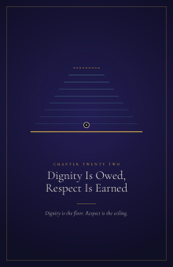

# 22 · Dignity Is Owed, Respect Is Earned

> *Dignity is the floor. Respect is the ceiling.*

Chapter Twenty-Two · [read the chapter](../book/4-the-principle/22-dignity-is-owed.md) · pages 134–137

 

## Before you begin — the falsifier

*“Do a Practice exactly as written, with your falsifier written first. If nothing you can observe changes, the practice failed for you. That is a result, and it counts.”* — Corrections and Open Accounts

If this practice works for me, I will be able to observe:

> &nbsp;

If it does not, I will see instead:

> &nbsp;

## ▲ Practice

> Keep the ledger for seven days. Three columns, one line a day in each: given, earned, spent. Do not total it. On the seventh day read down the third column and choose one entry to repair.

| Date | What I did, exactly as written | What I observed |
|---|---|---|
|  |  |  |
|  |  |  |
|  |  |  |

## ◆ Audit

> Where do you demand a respect you have not earned? And where do you withhold dignity until it has been earned? Both are the same confusion of floor and ceiling, run in opposite directions. Name one of each.

My honest answer:

> &nbsp;

## Result

- [ ] The falsifier was written before the practice began.
- [ ] Something I could observe changed.
- [ ] Nothing changed — the practice failed for me, and that result is recorded here.

---

Nothing here is medical, psychological, or legal advice. The practices are yours to try and yours to stop.

<a href="README.md">Workbook</a> · <a href="../book/4-the-principle/22-dignity-is-owed.md">Chapter</a>

