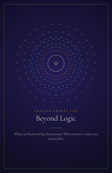

# 25 · Beyond Logic

> *What can be proved has been proved. What remains is what was always first.*

Chapter Twenty-Five · [read the chapter](../book/5-the-proof/25-beyond-logic.md) · pages 198–202

 

## Before you begin — the falsifier

*“Do a Practice exactly as written, with your falsifier written first. If nothing you can observe changes, the practice failed for you. That is a result, and it counts.”* — Corrections and Open Accounts

If this practice works for me, I will be able to observe:

> &nbsp;

If it does not, I will see instead:

> &nbsp;

## ▲ Practice

> Return to Level One. Beside each line, write one deed from the past month in which that line was true of you — something you did, on a day you can name. Where you cannot write a deed, write nothing. For you, that line is still only argued. It is waiting for you to live it.

| Date | What I did, exactly as written | What I observed |
|---|---|---|
|  |  |  |
|  |  |  |
|  |  |  |

## ◆ Audit

> Which kind of knowing do you use to escape the others? Proof, to avoid living. Feeling, to avoid checking. Experience, to avoid being wrong. Everyone has a favorite. Name yours. That is the last audit, and like the audit of Chapter Fifteen, it does not close.

My honest answer:

> &nbsp;

## Result

- [ ] The falsifier was written before the practice began.
- [ ] Something I could observe changed.
- [ ] Nothing changed — the practice failed for me, and that result is recorded here.

---

Nothing here is medical, psychological, or legal advice. The practices are yours to try and yours to stop.

<a href="README.md">Workbook</a> · <a href="../book/5-the-proof/25-beyond-logic.md">Chapter</a>

