
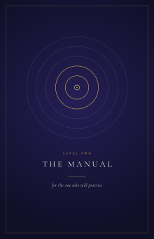

<h1 align="center">The Workbook</h1>

<i>Read one chapter. Do its practice. Then read the next.</i>

Every chapter of Levels Two to Four ends in a **Practice** — something done today — and an **Audit** — a question that can find the chapter wrong. This folder turns each of them into a sheet you can copy, fill and keep: the falsifier first, the practice as written, the audit, and for the fifteen chapters of the Manual the graded line from Level Three, to mark now and again in a month.

**How to use it.** Copy a sheet into your own notes (or fork this repository and fill it in your fork — your answers are yours, so keep them in a private fork). Write the falsifier before you begin. Record what happened, including nothing.

<table>
<tr><td align="center" valign="top" width="20%"><a href="01-the-three-and-the-zero.md">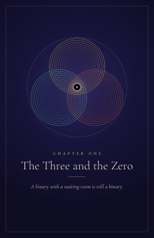</a> <b>1</b> · The Three and the Zero</td><td align="center" valign="top" width="20%"><a href="02-the-given.md">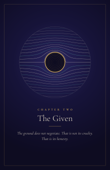</a> <b>2</b> · The Given</td><td align="center" valign="top" width="20%"><a href="03-attention.md">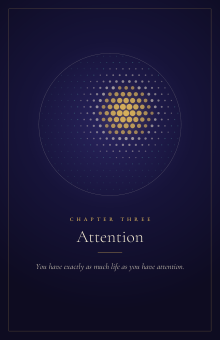</a> <b>3</b> · Attention</td><td align="center" valign="top" width="20%"><a href="04-witness.md">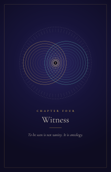</a> <b>4</b> · Witness</td><td align="center" valign="top" width="20%"><a href="05-name-the-binary.md">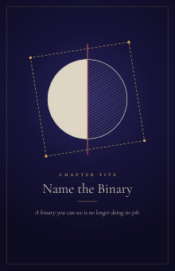</a> <b>5</b> · Name the Binary</td></tr>
<tr><td align="center" valign="top" width="20%"><a href="06-construct-the-third.md">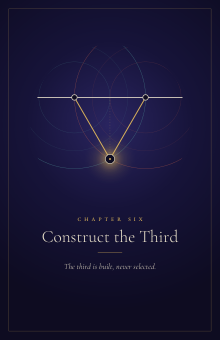</a> <b>6</b> · Construct the Third</td><td align="center" valign="top" width="20%"><a href="07-own-the-ground.md">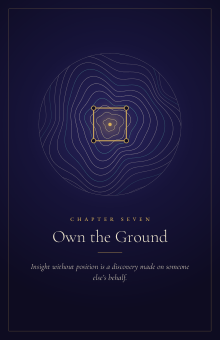</a> <b>7</b> · Own the Ground</td><td align="center" valign="top" width="20%"><a href="08-keep-the-middle.md">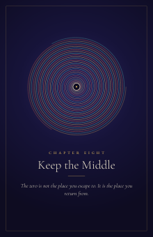</a> <b>8</b> · Keep the Middle</td><td align="center" valign="top" width="20%"><a href="09-refuse-the-waiting-room.md">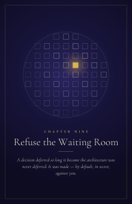</a> <b>9</b> · Refuse the Waiting Room</td><td align="center" valign="top" width="20%"><a href="10-the-asymmetry.md">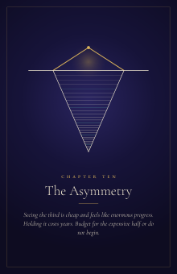</a> <b>10</b> · The Asymmetry</td></tr>
<tr><td align="center" valign="top" width="20%"><a href="11-continuity.md">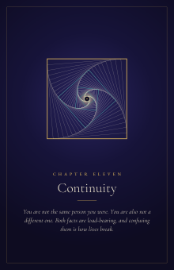</a> <b>11</b> · Continuity</td><td align="center" valign="top" width="20%"><a href="12-the-losable-claim.md">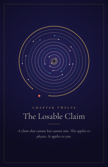</a> <b>12</b> · The Losable Claim</td><td align="center" valign="top" width="20%"><a href="13-empathy-as-catalyst.md">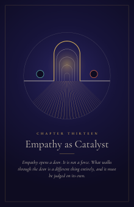</a> <b>13</b> · Empathy as Catalyst</td><td align="center" valign="top" width="20%"><a href="14-the-inviolate.md">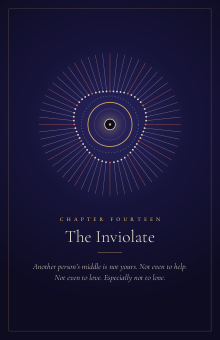</a> <b>14</b> · The Inviolate</td><td align="center" valign="top" width="20%"><a href="15-the-long-reclamation.md">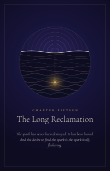</a> <b>15</b> · The Long Reclamation</td></tr>
<tr><td align="center" valign="top" width="20%"><a href="16-the-degree.md">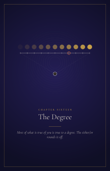</a> <b>16</b> · The Degree</td><td align="center" valign="top" width="20%"><a href="17-the-weakest-link.md">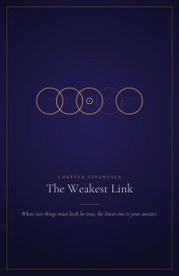</a> <b>17</b> · The Weakest Link</td><td align="center" valign="top" width="20%"><a href="18-act-crisp.md">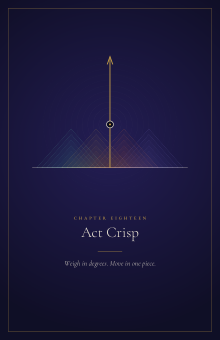</a> <b>18</b> · Act Crisp</td><td align="center" valign="top" width="20%"><a href="19-existence-is-sufficient.md">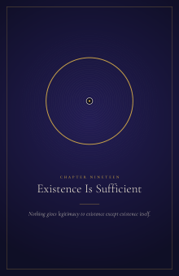</a> <b>19</b> · Existence Is Sufficient</td><td align="center" valign="top" width="20%"><a href="20-three-relationships.md">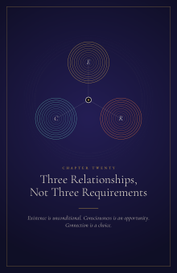</a> <b>20</b> · Three Relationships, Not Three Requirements</td></tr>
<tr><td align="center" valign="top" width="20%"><a href="21-change-without-erasure.md">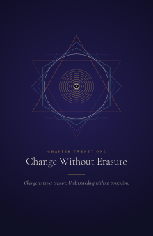</a> <b>21</b> · Change Without Erasure</td><td align="center" valign="top" width="20%"><a href="22-dignity-is-owed.md">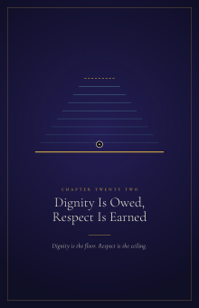</a> <b>22</b> · Dignity Is Owed, Respect Is Earned</td><td align="center" valign="top" width="20%"><a href="25-beyond-logic.md">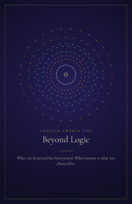</a> <b>25</b> · Beyond Logic</td></tr>
</table>

See also: [The Graded Audits](../book/3-the-degree/19-the-graded-audits.md) · [The Fifteen Lines](../book/2-the-manual/16-the-fifteen-lines.md) · [The Discipline in One Page](../book/6-back-matter/01-the-discipline-in-one-page.md)

Nothing here is medical, psychological, or legal advice. The practices are yours to try and yours to stop.

